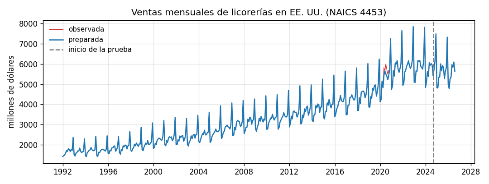
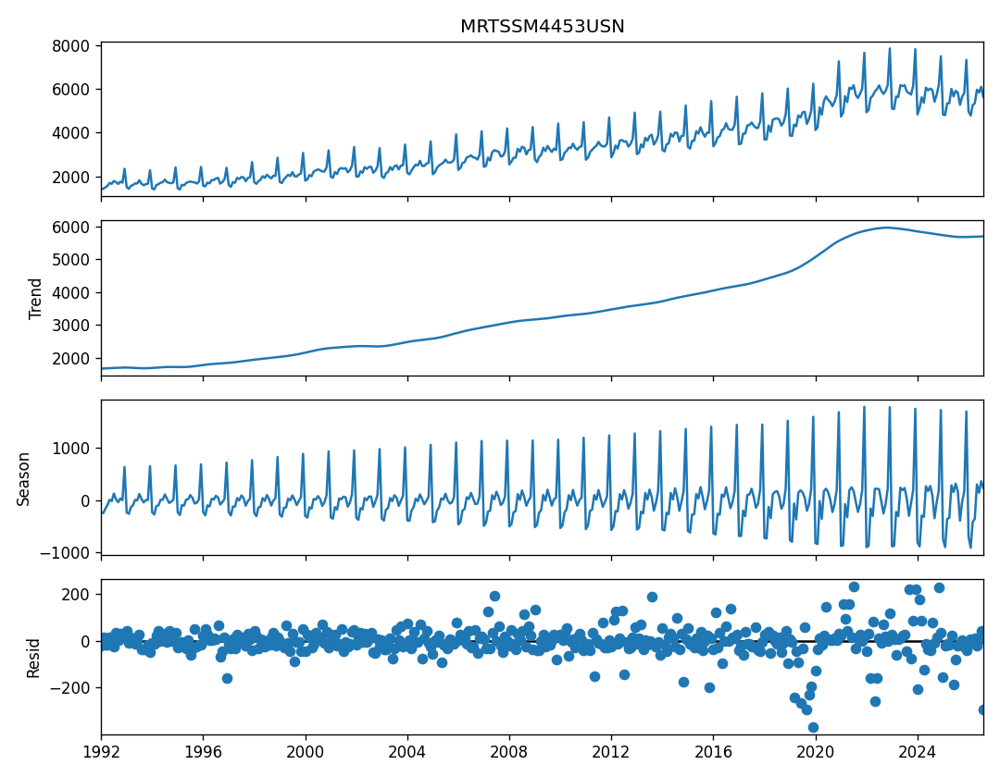
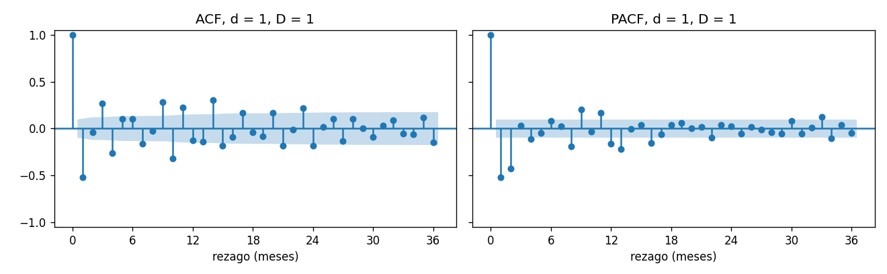
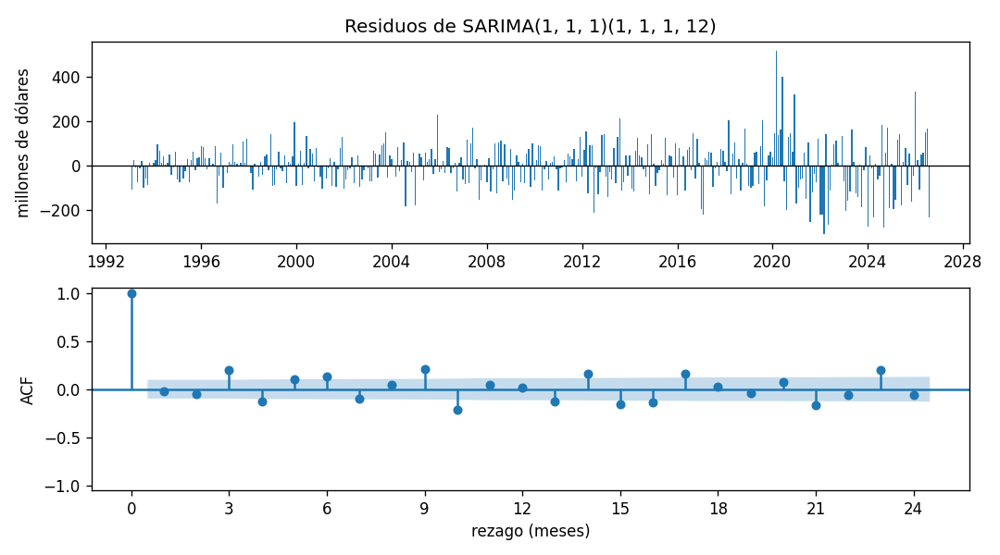

# Informe del miniproyecto 1

Todas las cifras de este informe salen de `python miniproyecto.py`, y las
figuras son las que ese guion deja en `figuras/`.

## 1. La serie

La serie son las ventas mensuales de las licorerías de Estados Unidos
(cerveza, vino y licor; código NAICS 4453), en millones de dólares corrientes
y sin ajuste estacional. La publica el U.S. Census Bureau en su encuesta
mensual de comercio minorista y la distribuye FRED con el código
`MRTSSM4453USN`. Es una obra del gobierno de EE. UU., de dominio público, y
FRED solo pide citar la fuente. Va de enero de 1992 a agosto de 2026: 416
observaciones mensuales. La ficha completa está en `datos/README.md`.

La elegimos porque cumple de sobra las condiciones del enunciado y porque
tiene tres rasgos que el curso permite estudiar: un pico de diciembre muy
marcado, una tendencia que sube durante tres décadas y un salto de nivel en
2020, con la pandemia. Además, una licorería vende más los viernes y los
sábados, y cuántos de esos días trae cada mes se sabe con años de antelación.
Eso nos da una exógena natural para el SARIMAX.

Huecos: la serie no tiene meses vacíos (el guion imprime `0 vacíos`). Aun
así, `preparar` deja escrita la regla del curso, interpolación lineal, por si
una descarga futura trae alguno.

Datos atípicos: para encontrarlos usamos los residuos de una STL robusta
con periodo 12 y marcamos los meses con
$|r_t| > 3\,\hat\sigma_r$, donde $\hat\sigma_r$ es la desviación estándar del
residuo. En toda la serie salen 13 meses: 2019-03, 2019-06, 2019-09, 2019-12,
2020-05, 2020-07, 2020-08, 2020-09, 2020-10, 2021-01, 2021-04, 2022-05 y
2026-08. No los tratamos igual:

- Los siete que caen entre marzo de 2020 y diciembre de 2021 son el tramo de
  la pandemia, cuando la serie da un salto que no tiene antecedentes en los
  28 años anteriores. Esos siete meses se cambian por el valor que da la STL sin el
  residuo, $\tilde y_t = T_t + S_t$. Por ejemplo, julio de 2020 pasa de 5.995
  a 5.500 millones y mayo de 2020 de 5.822 a 5.440. La tendencia $T_t$ se
  conserva, así que el salto de nivel de 2020, que no se revirtió después,
  sigue en la serie. Lo que se quita son los picos de cada mes, que el SARIMA
  leería como parte de su dinámica.
- Los cuatro de 2019 y el de 2022-05 tienen residuo negativo y están pegados
  al salto. La tendencia de la STL es suave: empieza a subir antes de 2020,
  así que los meses de 2019 quedan por debajo de ella, y todavía se está
  acomodando al nivel nuevo en 2022. Esos residuos los produce el suavizado
  alrededor del salto, no un dato raro, así que se dejan.
- 2026-08 está dentro de los 24 meses de prueba del *backtest*. Cambiar un
  dato que se usa para medir el error falsearía la medición. Por eso
  `atipicos` solo busca dentro de `CHOQUE` (2020-03 a 2021-12) y además
  excluye explícitamente los últimos `N_PRUEBA = 24` meses.

La decisión queda en una línea en `DECISION` y pasa a la columna `decision`
de la tabla. Hay que reconocer un límite: la STL que define los atípicos y la
desviación $\hat\sigma_r$ se calculan con toda la serie, y lo mismo pasa con
la elección de $d$, $D$ y de los órdenes por AIC en las secciones 4 y 5. Los
meses que se cambian son de 2020 y 2021, casi tres años antes del primer
origen, y los valores de prueba quedan intactos. Dentro del *backtest*, en
cambio, cada pronóstico usa solo los datos hasta su origen.

## 2. Componentes

La STL robusta con `period=12` sobre la serie preparada da esta lectura:

- La tendencia sube de 1.672 millones en enero de 1992 a 5.697 en agosto
  de 2026, 3,4 veces. Casi toda esa subida es gradual; el tramo distinto es
  la pandemia: entre diciembre de 2019 y diciembre de 2021 la tendencia pasa
  de 5.023 a 5.861 millones, 838 más en dos años, y luego se queda en ese
  nivel.
- En la estacional, diciembre es el mes alto, con +1.190 millones en promedio
  sobre la tendencia. Febrero (−529) y enero (−513) son los bajos, seguidos de
  abril (−218) y marzo (−188). Julio (+163), noviembre (+106) y mayo (+99)
  quedan algo arriba. El patrón crece con el nivel de la serie: la
  estacional de diciembre pasa de +631 millones en 1992 a +1.688 en 2025.
- El residuo tiene una desviación estándar de 67 millones. El residuo más
  grande es el de diciembre de 2019, −369 millones, y se explica por lo
  dicho en la sección 1: la tendencia ya está subiendo hacia el nivel de
  2020 y ese diciembre queda por debajo.

## 3. Líneas base y *backtest*

El *backtest* es el de `comun.py`: origen móvil sobre los últimos 24 meses y
horizonte de 1 a 12. Los meses de prueba van de 2024-09 a 2026-08. Hay
$24 - 12 + 1 = 13$ orígenes, de 2024-08 a 2025-08, porque cada origen
necesita 12 meses reales por delante para compararse. En el primero quedan
392 meses de entrenamiento.

En cada origen el modelo es una función `modelo(entrenamiento, h)` que recibe
`serie.iloc[:corte]` y nada más. El SARIMA y el SARIMAX se vuelven a ajustar
en cada origen con esos datos. La exógena del SARIMAX se pide con
`x.loc[entrenamiento.index]` para ajustar y con
`x.loc[fechas_siguientes(entrenamiento, h)]` para pronosticar, y es una
variable de calendario: su valor para los 12 meses siguientes se conoce en
el origen.

Las métricas, promediadas sobre los 13 orígenes, son

$$\text{RMSE} = \sqrt{\frac{1}{h}\sum_{k=1}^{h}(y_{t+k}-\hat y_{t+k})^2},\qquad
\text{MAE} = \frac{1}{h}\sum_{k=1}^{h}|y_{t+k}-\hat y_{t+k}|,\qquad
\text{MAPE} = \frac{100}{h}\sum_{k=1}^{h}\left|\frac{y_{t+k}-\hat y_{t+k}}{y_{t+k}}\right|.$$

| Modelo | RMSE | MAE | MAPE (%) |
|---|---|---|---|
| ingenuo, $\hat y_{t+k} = y_t$ | 851,92 | 679,45 | 11,92 |
| estacional ingenuo, $\hat y_{t+k} = y_{t+k-12}$ | 178,38 | 144,89 | 2,55 |

El estacional ingenuo gana en las tres métricas. El ingenuo repite el último
mes durante un año entero, así que no sabe que diciembre sube unos 1.190
millones y que enero y febrero caen más de 500. Con un origen en agosto, por
ejemplo, pronostica para diciembre el valor de agosto. El estacional ingenuo
copia el mismo mes del año anterior y recoge ese patrón, aunque no la
tendencia. Su MAE dice que falla en promedio por unos 145 millones de
dólares al mes, el 2,55 % de las ventas.

## 4. Estacionariedad e identificación

La prueba ADF tiene como hipótesis nula una raíz unitaria (serie no
estacionaria) en la regresión

$$\Delta y_t = \alpha + \beta t + \gamma\, y_{t-1} + \sum_{j=1}^{k}\delta_j\,\Delta y_{t-j} + \varepsilon_t,
\qquad H_0:\ \gamma = 0,$$

con el número de rezagos $k$ elegido por AIC (`autolag="AIC"`). La serie
original se prueba con `regression="ct"` (constante y tendencia, $\beta \neq 0$),
porque tiene una tendencia clara: con solo constante su valor p es 0,9064, y
la prueba confundiría la tendencia con una raíz unitaria. Las versiones
diferenciadas ya no tienen tendencia y se prueban con `regression="c"`.

| Versión | d | D | `regression` | Estadístico | Rezagos | Valor p | ACF en el rezago 12 |
|---|---|---|---|---|---|---|---|
| original | 0 | 0 | ct | −2,900 | 14 | 0,1623 | 0,93 |
| `diff()` | 1 | 0 | c | −2,953 | 13 | 0,0395 | 0,95 |
| `diff(12)` | 0 | 1 | c | −2,577 | 16 | 0,0978 | 0,32 |
| `diff(12).diff()` | 1 | 1 | c | −6,726 | 16 | 0,0000 | −0,13 |

Con la regla del taller 1, la combinación con menos diferencias y valor p
bajo 0,05, ganaría `diff()`: $d = 1$, $D = 0$. No la aceptamos. Su valor p,
0,0395, pasa por poco, y la ACF de esa serie vale 0,95 en el rezago 12. Un
valor así en una serie que ya debería ser estacionaria indica que el patrón
anual sigue entero. La ADF mira la raíz unitaria del rezago 1 y tiene poca
potencia para la raíz unitaria estacional.

Por eso el guion pide dos condiciones: valor p bajo 0,05 y
$|r_{12}| < 0{,}5$. Solo las cumple `diff(12).diff()`, con valor p de 0,0000
y $r_{12} = -0{,}13$, así que trabajamos con $d = 1$ y $D = 1$:

$$w_t = (1-B)(1-B^{12})\,y_t = y_t - y_{t-1} - y_{t-12} + y_{t-13}.$$

`diff(12)` sola no pasa (0,0978): después de quitar el patrón anual queda la
tendencia, que crece de año en año y obliga a la diferencia regular.

Sobre $w_t$ quedan 403 meses. La banda de la PACF es
$\pm 1{,}96/\sqrt{403} = \pm 0{,}098$. La de la ACF usa la fórmula de
Bartlett, que se abre con el rezago, así que en los rezagos altos es más
ancha que 0,098.

- En la ACF salen de la banda los rezagos 1, 3, 4, 7, 9, 10, 11, 14, 15, 17,
  20, 21, 23 y 24. El rezago 1 vale −0,52 y el 2 apenas −0,04: la ACF corta
  después del primer rezago, que es la firma de un MA(1) regular. En la
  parte estacional, $r_{12} = -0{,}13$ queda dentro de la banda de Bartlett
  y $r_{24} = -0{,}19$ sale. Los dos son negativos, el signo que suele dejar
  una diferencia estacional y que se modela con un MA estacional ($Q = 1$).
  La señal es débil, y la rejilla por AIC decide.
- En la PACF salen el 1, 2, 4, 8, 9, 11, 12, 13, 16, 22, 33 y 34. La PACF
  empieza en −0,52 y −0,43 y decae, lo que también es coherente con un MA(1)
  regular; un AR(1) o AR(2) es la alternativa. En el 12 sale con −0,16; un
  valor negativo ahí también se asocia más a un MA estacional que a un AR,
  pero dejamos $P$ en la rejilla para que el AIC lo compare.
- Los rezagos sueltos como el 3, 4, 9 o 10 no los alcanza un modelo con
  órdenes 0 y 1. Nuestra hipótesis es que vienen del calendario: la mezcla de
  días de la semana de cada mes se repite con ciclos que no son de 12 meses.
  La sección 5 vuelve sobre esto.

Con esta lectura, la rejilla con $p, q, P, Q \in \{0, 1\}$ cubre los órdenes
que sugieren la ACF y la PACF.

## 5. Modelos clásicos

Los modelos se ajustan sobre `serie / ESCALA`, con `ESCALA = 1000`, es decir,
en miles de millones de dólares (valores entre 1,4 y 7,8). Así los
coeficientes y $\sigma^2$ quedan en tamaños parecidos y el optimizador
converge bien. El pronóstico se multiplica de vuelta por `ESCALA`. Por esa
escala los AIC salen negativos; lo que importa es la diferencia entre ellos.

La rejilla tiene los 16 SARIMA con $d = 1$ y $D = 1$ fijos. $d$ y $D$ no
compiten por AIC porque cambian la serie que se modela, y el AIC solo compara
modelos sobre los mismos datos. Ordenada por AIC:

| # | `order` | `seasonal_order` | AIC |
|---|---|---|---|
| 1 | (1, 1, 1) | (1, 1, 1, 12) | −693,4 |
| 2 | (1, 1, 1) | (0, 1, 1, 12) | −686,0 |
| 3 | (0, 1, 1) | (1, 1, 1, 12) | −684,3 |
| 4 | (1, 1, 1) | (1, 1, 0, 12) | −674,8 |
| 5 | (0, 1, 1) | (0, 1, 1, 12) | −672,2 |
| 6 | (0, 1, 1) | (1, 1, 0, 12) | −661,2 |
| 7 | (1, 1, 1) | (0, 1, 0, 12) | −658,4 |
| 8 | (0, 1, 1) | (0, 1, 0, 12) | −648,5 |
| 9 | (1, 1, 0) | (1, 1, 1, 12) | −628,2 |
| 10 | (1, 1, 0) | (0, 1, 1, 12) | −617,4 |
| 11 | (1, 1, 0) | (1, 1, 0, 12) | −606,3 |
| 12 | (1, 1, 0) | (0, 1, 0, 12) | −596,3 |
| 13 | (0, 1, 0) | (1, 1, 1, 12) | −502,0 |
| 14 | (0, 1, 0) | (0, 1, 1, 12) | −480,3 |
| 15 | (0, 1, 0) | (1, 1, 0, 12) | −471,7 |
| 16 | (0, 1, 0) | (0, 1, 0, 12) | −466,8 |

Gana el SARIMA(1,1,1)(1,1,1)$_{12}$ con AIC de −693,4, 7,4 por debajo del
segundo, que es el mismo modelo sin el AR estacional. Los ocho primeros
puestos tienen $q = 1$, como anticipaba el corte de la ACF en el rezago 1, y
los cuatro últimos, sin ninguna memoria regular, quedan unos 190 puntos
atrás. Con $B$ el operador de rezago ($B y_t = y_{t-1}$), el modelo es

$$(1-\phi_1 B)(1-\Phi_1 B^{12})(1-B)(1-B^{12})\,y_t = (1+\theta_1 B)(1+\Theta_1 B^{12})\,\varepsilon_t,$$

con $\hat\phi_1 = -0{,}228$, $\hat\theta_1 = -0{,}552$,
$\hat\Phi_1 = 0{,}306$, $\hat\Theta_1 = -0{,}618$ y
$\hat\sigma^2 = 0{,}010$ (en miles de millones al cuadrado). Los cuatro
coeficientes tienen valor p menor que 0,01. Leídos sobre $w_t$: el
$\theta_1$ negativo corrige una parte de la sorpresa del mes anterior, el
$\Theta_1 = -0{,}618$ hace lo mismo con la sorpresa del mismo mes del año
anterior, y el $\Phi_1 = 0{,}306$ arrastra un 31 % del cambio que tuvo ese
mes hace un año.

Para el diagnóstico de los residuos se descartan los primeros
$d + 12D = 13$ residuos, que son de arranque, y quedan 403, con desviación
estándar de 101 millones. La prueba de Ljung-Box tiene como hipótesis nula
que los residuos no tienen autocorrelación hasta el rezago $m$:

$$Q(m) = n(n+2)\sum_{k=1}^{m}\frac{\hat\rho_k^{\,2}}{n-k}.$$

| Rezagos | $Q$ | Valor p |
|---|---|---|
| 12 | 77,7 | 0,000 |
| 24 | 159,7 | 0,000 |

Se rechaza la nula en los dos: los residuos no son ruido blanco. La ACF de
los residuos muestra dónde queda la estructura: salen de la banda los
rezagos 3, 4, 5, 6, 9, 10, 13, 14, 15, 16, 17, 21 y 23, con valores
positivos cada tres meses ($r_3 = 0{,}20$, $r_6 = 0{,}13$, $r_9 = 0{,}21$) y
negativos en el 4 ($-0{,}13$) y el 10 ($-0{,}21$). Los rezagos 1, 2, 12 y 24,
que son los que el modelo cubre, quedan dentro ($r_1 = -0{,}03$,
$r_{12} = 0{,}01$), así que el SARIMA sí
recogió la memoria del mes anterior y la del año anterior. La varianza
tampoco es constante: la desviación de los residuos es de 79 millones hasta
2019 y de 163 desde 2020, y los tres mayores son marzo de 2020 (+515 millones), junio de
2020 (+397) y enero de 2026 (+332). Marzo de 2020 es el primer mes de la
pandemia; la regla de la sección 1 no lo marcó porque su residuo STL no pasó
de tres desviaciones.

Ese patrón de rezagos cortos y sueltos encaja con un efecto de calendario: un
mes con cinco viernes o cinco sábados vende más que uno con cuatro, y la
cantidad de esos días cambia de un mes a otro con ciclos que un SARIMA de
órdenes 0 y 1 no puede seguir.

El SARIMAX agrega al SARIMA dos variables de
calendario:

$$y_t = \beta_1\, v_t + \beta_2\, f_t + \eta_t,\qquad \eta_t \sim \text{SARIMA}(1,1,1)(1,1,1)_{12},$$

donde $v_t$ es el número de viernes y sábados del mes (entre 8 y 10, 8,7 en
promedio) y $f_t$ el número de festivos federales de EE. UU. del paquete
`holidays` (0,94 en promedio). Las dos salen del calendario, así que se
conocen años antes de cada mes. Con toda la serie:

| Variable | Coeficiente (millones de dólares) | Valor p |
|---|---|---|
| viernes y sábados | +47,3 por cada día de más | 0,000 |
| festivos | +12,4 por cada festivo de más | 0,273 |

Cada viernes o sábado adicional suma unos 47 millones de ventas en el mes,
con todo lo demás igual, y el efecto es claramente distinto de cero. Los
festivos no se distinguen de cero. El AIC baja de −693,4 sin exógenas a
−790,0 con ellas, y la desviación de los residuos de 101 a 89 millones.
Ljung-Box sigue rechazando ($Q(12) = 53{,}5$ y $Q(24) = 84{,}9$, valor p
0,000 en ambos), pero $Q(12)$ baja un 31 % y $Q(24)$ casi a la mitad. Las exógenas
explican parte de la estructura que quedaba en los residuos.

En el *backtest* el SARIMAX mejora al SARIMA: el RMSE baja de 141,19 a
121,80 (13,7 % menos), el MAE de 115,14 a 98,38 y el MAPE de 2,06 % a 1,78 %.

Si la exógena no se conociera de antemano, por ejemplo la temperatura o el
gasto de los hogares del mismo mes, el modelo necesitaría su valor futuro
para pronosticar. Usar el valor real sería fuga de información: el
*backtest* mediría un error que en la práctica no se puede lograr. La
alternativa honesta sería pronosticar también la exógena, y su error se
sumaría al de las ventas.

## 6. Tabla de métricas

`resultados/metricas.csv`, ordenada por RMSE. Las cuatro filas comparten la
decisión sobre los datos, así que las diferencias vienen solo del modelo.

| Modelo | Decisión | RMSE | MAE | MAPE (%) |
|---|---|---|---|---|
| SARIMAX(1, 1, 1)(1, 1, 1, 12) + exógenas | sin huecos (regla: interpolación lineal); meses de 2020-2021 con residuo STL > 3 desv. cambiados por tendencia + estacional | 121.80 | 98.38 | 1.78 |
| SARIMA(1, 1, 1)(1, 1, 1, 12) | sin huecos (regla: interpolación lineal); meses de 2020-2021 con residuo STL > 3 desv. cambiados por tendencia + estacional | 141.19 | 115.14 | 2.06 |
| estacional ingenuo | sin huecos (regla: interpolación lineal); meses de 2020-2021 con residuo STL > 3 desv. cambiados por tendencia + estacional | 178.38 | 144.89 | 2.55 |
| ingenuo | sin huecos (regla: interpolación lineal); meses de 2020-2021 con residuo STL > 3 desv. cambiados por tendencia + estacional | 851.92 | 679.45 | 11.92 |

## 7. Conclusión

El mejor modelo clásico es el SARIMAX(1,1,1)(1,1,1)$_{12}$ con los viernes y
sábados y los festivos de cada mes como exógenas. Frente a la mejor línea
base, el estacional ingenuo:

| Métrica | Estacional ingenuo | SARIMAX | Mejora |
|---|---|---|---|
| RMSE | 178,38 | 121,80 | 31,7 % |
| MAE | 144,89 | 98,38 | 32,1 % |
| MAPE (%) | 2,55 | 1,78 | 30,2 % |

La mejora tiene dos partes. El SARIMA solo ya baja el RMSE de 178,38 a
141,19, porque además de copiar el año anterior sigue la tendencia y corrige
con las sorpresas recientes. La exógena baja el resto, de 141,19 a 121,80:
ni el estacional ingenuo ni el SARIMA saben que el mes que se pronostica
puede tener cinco sábados cuando el del año anterior tuvo cuatro.

El SARIMAX sigue fallando en algunos meses. Por mes del año, sus errores
absolutos medios más altos son junio (175 millones), enero (155) y
noviembre (140); los más bajos, octubre (46) y agosto (47). En el
estacional ingenuo los peores eran noviembre (265), junio (254) y diciembre
(215); el SARIMAX baja diciembre a 82 y noviembre a 140, pero en enero
empeora (155 frente a 100) y en abril también (82 frente a 16). Por tramo, sobreestimó los meses de 2024-09 (−220 millones en
promedio sobre los orígenes que lo pronosticaron), 2025-02 (−203) y 2025-11
(−163), y subestimó 2026-06 (+247), 2026-01 (+234) y 2026-07 (+233). En
varios meses de 2024 y 2025 las ventas quedaron por debajo de lo que
proyectaba el modelo y en varios de 2026 por encima, lo que sugiere que
sigue los cambios de nivel con retraso.
Además, Ljung-Box muestra que a los residuos todavía les queda estructura, y
su varianza creció después de 2020.

Este SARIMAX, con RMSE de 121,80, MAE de 98,38 y MAPE de 1,78 %, es el modelo
que el miniproyecto 2 tiene que superar.
